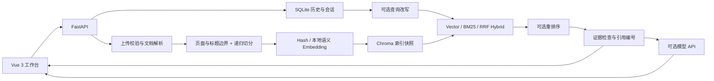

# RAG Studio

基于 FastAPI 和 Vue 3 的本地文档问答工作台。将 PDF、Word、文本及 Markdown 文档转换为可检索的知识库，结合向量检索、BM25 与来源引用辅助回答问题。

默认使用离线 Hash Embedding，无需 GPU 或模型 API 即可体验文档解析与检索。配置兼容 OpenAI 协议的 API 后，可基于检索证据生成回答。

> 当前版本包含 V2 后端能力，前端保留可用的问答、知识库、历史记录与模型配置页面。多会话聊天界面、Markdown 渲染和独立系统概览页面尚未完成，详见[验证记录](docs/VALIDATION.md)。

## 目录

- [主要功能](#主要功能)
- [系统架构](#系统架构)
- [快速开始](#快速开始)
- [配置说明](#配置说明)
- [API 接口](#api-接口)
- [项目结构](#项目结构)
- [测试与评测](#测试与评测)
- [数据管理与使用边界](#数据管理与使用边界)
- [GitHub 发布](#github-发布)

## 主要功能

| 功能 | 说明 |
| --- | --- |
| 文档导入 | 支持 `.pdf`、`.docx`、`.txt`、`.md`、`.markdown`；单文件上限 20 MiB；校验文件名、扩展名和可解析内容 |
| 文档切分 | RecursiveCharacterTextSplitter；支持长度和重叠配置；记录 PDF 页码、标题、片段编号及解析文本字符范围 |
| 三种检索 | Vector Search、BM25 Keyword Search、基于 RRF 的 Hybrid Search；支持来源过滤 |
| 可选重排 | 可关闭，或使用轻量规则重排、本地语义重排；语义重排不可用时降级并提示 |
| 来源追踪 | 引用编号、来源文件、页码、章节与原文片段 |
| 模型管理 | 添加、启用、删除 API 配置；连接测试；API Key 脱敏返回 |
| 安全索引更新 | 新快照构建成功后切换活动指针；失败保留旧索引；同名上传失败恢复旧文件 |
| 历史记录 | SQLite 保存问答历史；后端另提供独立会话、消息、标题和查询改写接口 |
| 模型兼容检查 | 记录 Embedding 模型指纹；切换模型或版本后提示重建 |
| 本地运行 | 统一 Windows 启动入口；启动前检查原生索引依赖；默认监听回环地址 |

## 系统架构



RAG 流程：上传与解析 → 按页码、标题切分 → 生成向量并发布索引快照 → 检索与重排 → 构建引用上下文 → 生成回答或展示本地检索证据。

| 层级 | 技术 |
| --- | --- |
| 前端 | Vue 3、TypeScript、Element Plus、Vite |
| API | Python、FastAPI、Pydantic、Uvicorn |
| 文档处理 | pypdf、python-docx、LangChain Text Splitters |
| 检索与存储 | Chroma、Hash Embedding、BM25、RRF、SQLite |
| 可选语义模型 | Sentence Transformers / Cross Encoder，CPU、本地权重 |
| 验证 | pytest、HTTP 集成测试、独立检索评测脚本 |

## 快速开始

### 环境要求

- Python **3.11，64 位**：当前已验证的运行环境。
- Node.js **20 或更高版本**，包含 npm。
- Windows 一键启动使用 PowerShell 5.1 或更高版本。
- 首次安装依赖需要网络；默认 Hash 模式运行时不下载模型权重。

原生依赖使用已验证的固定组合：Chroma `0.5.3`、chroma-hnswlib `0.7.3`、NumPy `1.26.4`、ONNX Runtime `1.19.2`。请使用项目虚拟环境安装 `requirements.txt`，避免混用全局 Python 依赖。[上传崩溃排查说明](docs/UPLOAD_FIX.md)记录了固定这些版本的原因。

### Windows 一键启动

下载或克隆项目后，在项目根目录首次运行：

```powershell
.\install_and_start.bat
```

脚本创建 `.venv`、安装前后端依赖、检查原生运行环境并启动服务。后续运行：

```powershell
.\start_all.bat
```

工作台：<http://127.0.0.1:5173>。API 文档：<http://127.0.0.1:8000/docs>。

在启动窗口按 **Ctrl+C** 停止本次启动的前后端服务。端口被占用时，脚本显示占用进程并停止启动；日志位于 `data/logs/`。

### 手动启动

在项目根目录创建虚拟环境并启动后端：

```powershell
python -m venv .venv
.\.venv\Scripts\python.exe -m pip install -r requirements.txt
Copy-Item .env.example .env
.\.venv\Scripts\python.exe -X faulthandler scripts/check_runtime.py
.\.venv\Scripts\python.exe -m uvicorn main:app --host 127.0.0.1 --port 8000 --workers 1
```

另开终端启动前端：

```powershell
cd frontend
npm ci
npm run dev
```

`.env` 是可选配置；已有配置时无需覆盖。前端开发服务通过 `/api` 代理访问后端。`npm run build` 生成 `frontend/dist/`，正式静态部署仍需要配置 API 代理。

### 第一次使用

1. 在“知识库”选择或拖入支持的文件，然后上传。
2. 在“智能问答”选择检索模式、Top-K 和来源范围，提交问题。
3. 查看引用卡片，核对原文、页码和章节。
4. 如需模型生成回答，在“模型配置”添加 API 配置并进行连接测试。

可上传 `examples/corpus/` 中的公开样例体验检索。未配置 API 时，页面展示检索片段与明确提示。

## 配置说明

### 模型 API

复制 `.env.example` 为 `.env`，填写以下字段，或在前端模型配置页面添加配置：

```dotenv
LLM_API_KEY=
LLM_BASE_URL=https://api.deepseek.com
LLM_MODEL=deepseek-chat
```

`LLM_API_KEY` 需填入自己的密钥。远程 Base URL 必须使用 HTTPS，本机模型服务允许回环地址上的 HTTP。API 是否可用取决于提供方、账户额度和网络。

活动模型配置优先于环境变量，旧 `DEEPSEEK_*` 环境变量继续兼容。前端收到的密钥为脱敏值，本地配置文件仍保存明文，应保护本机数据目录。

### 检索与切分

| 环境变量 | 默认值 | 含义 |
| --- | --- | --- |
| `EMBEDDING_BACKEND` | `hash` | `hash` 或 `sentence-transformers` |
| `EMBEDDING_MODEL` | `sentence-transformers/paraphrase-multilingual-MiniLM-L12-v2` | 语义模型名称或本地目录 |
| `EMBEDDING_REVISION` | `local-v1` | 本地模型版本标签；替换权重时更新 |
| `CHUNK_SIZE` | `500` | 片段字符长度 |
| `CHUNK_OVERLAP` | `50` | 重叠字符数，必须小于片段长度 |
| `TOP_K` | `4` | 默认返回片段数 |
| `CANDIDATE_K` | `20` | 候选数，必须不小于 Top-K |
| `RERANKER` | `lightweight` | `none`、`lightweight` 或 `semantic` |
| `RERANKER_MODEL` | `cross-encoder/mmarco-mMiniLMv2-L12-H384-v1` | 本地语义重排模型 |
| `HISTORY_TURNS` | `6` | 单个会话历史轮数预算 |
| `HISTORY_CHARS` | `6000` | 单个会话历史字符预算 |
| `RAG_DATA_DIR` | 项目下 `data/` | 可选独立数据目录 |

`data/settings.json` 中保存的设置优先于环境默认值，可通过 `/settings` API 管理；问答请求显式传入的参数优先于对应默认值。当前前端支持 Top-K、候选数、检索模式和查询改写，尚未提供完整设置编辑器。

### 可选语义模型

显式安装可选依赖：

```powershell
.\.venv\Scripts\python.exe -m pip install -r requirements-semantic.txt
```

自行准备模型权重、本地目录或完整缓存，再配置 `EMBEDDING_BACKEND=sentence-transformers`。模型通过 `local_files_only=True` 在 CPU 上加载，运行时不会自动下载权重。可选依赖安装后，应重新运行原生运行环境检查。

模型名称及版本标签构成索引兼容信息。切换后，Vector / Hybrid 查询可能返回 `409` 并提示全库重建；BM25 可继续使用旧索引。更新切分参数后也应重建索引。新索引成功发布之前保留旧索引。

## API 接口

完整参数和返回结构以运行中的 `/docs` 为准。检索模式参数为 `vector`、`keyword`（BM25）和 `hybrid`。

| 方法 | 路径 | 用途 |
| --- | --- | --- |
| GET | `/health` | 健康检查 |
| POST | `/upload` | multipart 上传、解析与索引 |
| GET | `/sources` | 文档状态与片段数量 |
| DELETE | `/sources/{source_name}` | 仅删除索引，保留原文件 |
| POST | `/sources/{source_name}/reindex` | 重建单个文档索引 |
| DELETE | `/documents/{source_name}` | 移除索引并将原文件归档至备份目录 |
| POST | `/index/rebuild` | 全库重建 |
| POST | `/ask` | 问答、来源过滤、会话上下文和引用 |
| GET / DELETE | `/history` | 兼容旧版历史记录 |
| GET / POST | `/sessions` | 列出或新建会话 |
| GET | `/sessions/{session_id}/messages` | 读取该会话消息 |
| PATCH / DELETE | `/sessions/{session_id}` | 重命名或删除会话 |
| GET | `/overview` | 真实文档、片段、会话与模型信息 |
| GET / PUT | `/settings` | 查询或更新运行设置 |
| GET | `/llm/status` | 当前模型状态 |
| GET / POST | `/llm/configs` | 列出或新增模型配置 |
| POST | `/llm/configs/{config_id}/activate` | 启用配置 |
| DELETE | `/llm/configs/{config_id}` | 删除配置 |
| POST | `/llm/test` | 测试指定或活动配置 |

多轮问答需要先新建会话，再在 `/ask` 请求中传入同一个 `session_id`。历史只从该会话读取，受轮数和字符预算限制。当前前端使用旧版历史接口，多会话功能可通过 API 文档调用。

## 项目结构

```text
.
├── main.py                    # FastAPI 主入口
├── app.py                     # 保留的 Streamlit 兼容界面
├── modules/
│   ├── document_loader.py     # 文档解析
│   ├── text_splitter.py       # 切分与位置元数据
│   ├── uploads.py             # 上传校验、备份与回滚
│   ├── vector_store.py        # 检索、重排及索引快照
│   ├── rag_chain.py           # 查询改写、证据与回答
│   ├── conversations.py       # 独立会话与消息
│   ├── history.py             # 兼容历史存储
│   ├── llm_client.py          # 模型 API 调用
│   ├── llm_config_store.py    # 本地模型配置
│   ├── settings.py            # 参数与数据路径
│   └── chroma_telemetry.py    # 禁用产品遥测
├── frontend/src/              # Vue 界面、API、类型与样式
├── scripts/                   # 原生运行检查、源码发布打包
├── tests/                     # 隔离后端测试
├── examples/corpus/           # 公开评测文档
├── data/eval_questions.json   # 与公开样例对应的评测标注
├── docs/                      # 审查、验证、故障排查及截图说明
├── requirements*.txt          # 运行、开发和可选模型依赖
├── .env.example               # 无密钥的环境示例
└── start_all.bat              # Windows 日常启动入口
```

本地数据写入 `data/uploads/`、`data/vector_store/`、`data/db/` 等目录，这些数据不属于源码发布内容。`app.py` 为兼容旧版保留，默认启动脚本只启动 FastAPI 与 Vue。

## 测试与评测

在项目根目录运行：

```powershell
.\.venv\Scripts\python.exe -m pip install -r requirements-dev.txt
.\.venv\Scripts\python.exe -m pytest -q
.\.venv\Scripts\python.exe eval_rag.py --sample --all --top-k 3 --output docs/evaluation.json
```

构建前端：

```powershell
cd frontend
npm run build
```

测试覆盖文档解析、片段定位、检索、非法文件与参数、空知识库、模型失败、索引回滚、会话隔离及大批量 PDF 上传。结果和未验证项见 [docs/VALIDATION.md](docs/VALIDATION.md)。

评测使用仓库内 6 份公开样例与 12 条标注，在独立临时 Hash 索引中比较 Vector、BM25、Hybrid 和 Hybrid + Lightweight Reranker，不访问正式知识库或调用 LLM。

- **Recall@K**：召回的相关来源数 / 标注的相关来源总数。
- **MRR**：首个相关来源排名的倒数。
- **nDCG@K**：二元相关性下的归一化折损累积增益。

取前 K 个片段，再按来源文件名去重，使用完全匹配的来源集合计算。空标注记为 `null`，不进入均值。该小样例用于检索回归，不代表真实业务或语义模型质量；没有可靠的答案忠实性标注，因此不报告忠实性指标。

评测自己的索引时，可传入含 `question`、`expected_sources` 的标注 JSON：

```powershell
.\.venv\Scripts\python.exe eval_rag.py --file labels.json --mode hybrid --reranker none
```

截图预留在 [docs/screenshots/](docs/screenshots/README.md)，目前未附带截图。只应添加实际运行页面，并清理文档名称、问题内容及账号信息。

## 数据管理与使用边界

- 无登录认证，仅支持本机、单用户、单 worker。不要开放监听地址或通过反向代理暴露到公网；回环地址及 Origin 校验不能替代认证。
- 升级、手动恢复前停止服务并备份完整数据目录。同名文件替换后的旧文件保存到 `data/backups/`，确认无需恢复后可自行清理。
- 旧 SQLite 历史、模型配置格式及 `rag_documents` 集合保持兼容。活动快照由 `data/vector_store/active.json` 指向；异常中断时应检查指针及备份。
- PDF 字符范围对应解析后的文本；扫描 PDF 需要外部 OCR，复杂表格不保证保留布局。DOCX 保持段落与表格的读取顺序。
- Hash Embedding 属于离线特征检索。检索分数及兼容字段 `confidence` 是启发式等级，不是回答正确概率。
- 依据不足或模型失败时返回明确状态与本地证据。引用格式检查不等于语义忠实性验证，重要结论仍需核对原文。
- 提示词将检索内容视为不可信数据，以缓解文档提示注入；此机制不提供绝对防护。
- 快照复制与进程内串行更新适合个人小型知识库；大型语料和并发服务尚未验证。
- 当前不提供 Docker Compose；本地启动不依赖 Docker。非 Windows 平台尚未进行运行验收。

## GitHub 发布

`.gitignore` 排除密钥、上传文件、数据库、索引、备份、日志、虚拟环境、模型权重和构建产物。公开评测标注与空目录占位文件保留在仓库。

生成只包含项目源码、依赖文件、公开样例和文档的发布包：

```powershell
python scripts/prepare_release.py
```

结果为 `dist/rag-studio-source.zip`，不包含 `.git`、作者提交元数据、个人知识库或 API 配置。解压后可将其中的文件上传至新 GitHub 仓库；不要直接打包整个工作目录。打包脚本采用文件白名单，新增源码时需要同步更新白名单。

若直接推送现有 Git 仓库，已有提交仍包含作者姓名和邮箱，`.gitignore` 无法清理历史。源码包用于在新仓库发布，不修改本地提交历史。新提交可使用 GitHub 提供的隐私邮箱。

提交问题或改进时，请提供复现步骤、依赖版本与可公开的最小样例，勿附带真实密钥或私人文档。当前仓库尚未声明开源许可证；正式发布时应根据自己的授权意愿补充许可证。
